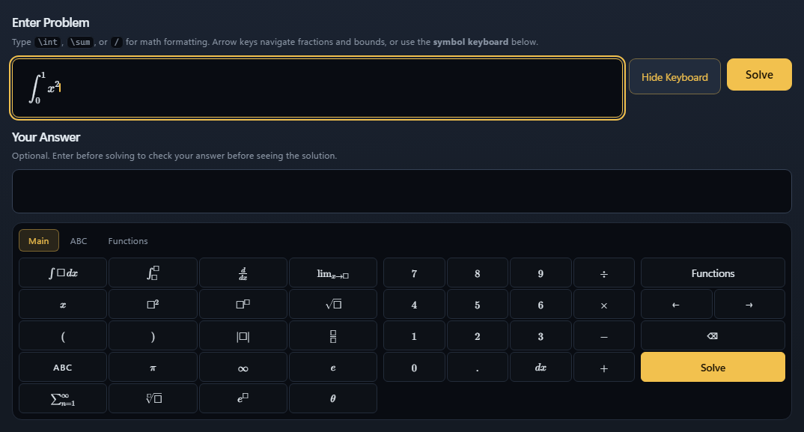
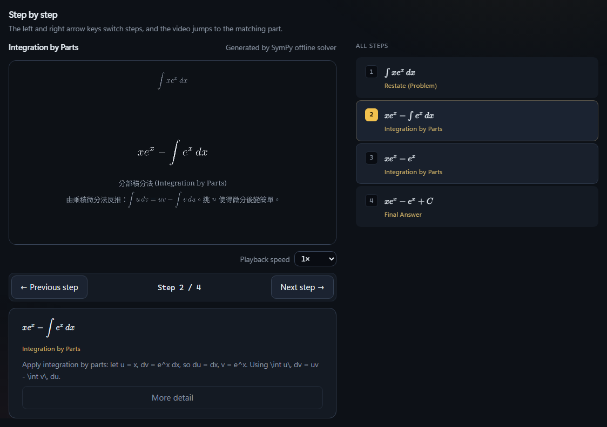
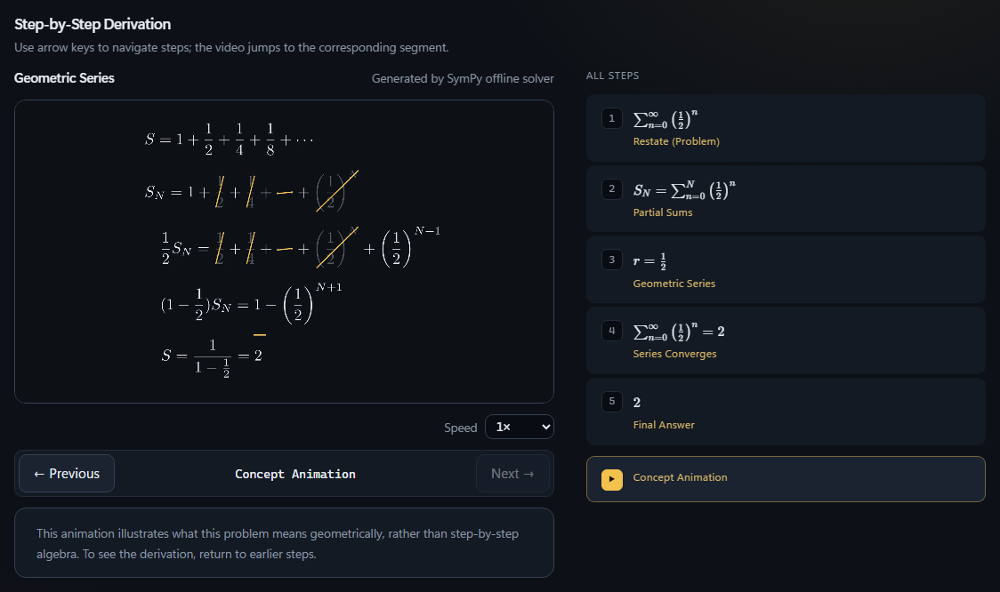
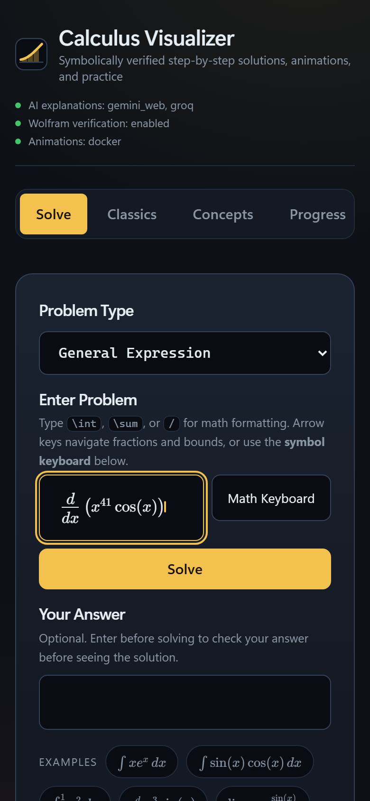
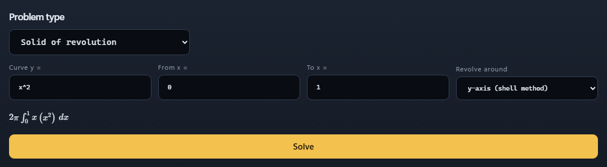
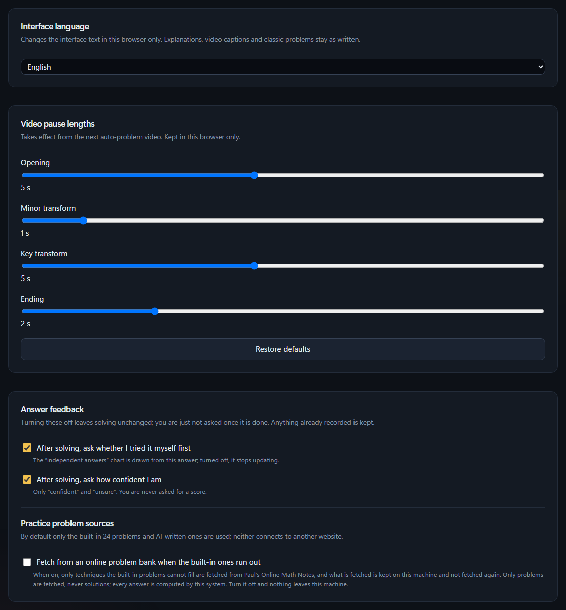

**English** | [繁體中文](README_zh.md)

# Calculus Visualizer

> A full-stack calculus tutor: React 19 + TypeScript (Vite) front end, Python FastAPI back end, SQLite storage. Multiple LLM agents solve each problem, SymPy verifies the answer symbolically, and Manim (in Docker) renders the steps into an explainer video.

> **This repository contains showcase artifacts only and does not include the source code.** The core project is private and all rights are reserved.

## What It Does

Enter any calculus problem (typed directly with `\int`, `\sum`, or using the on-screen math keyboard; kinds such as solids of revolution or Taylor expansions are picked from the Problem Type menu and filled in by field), and the system will:

1. **Solve**: Provide step-by-step mathematical derivations, clearly labeling which technique is used at each step (e.g., Integration by Parts).
2. **Verify**: Verify the answer symbolically with SymPy, with optional cross-checking via Wolfram|Alpha. The AI is responsible solely for natural language explanation and **does not determine mathematical correctness**. If the model fails to respond, the system gracefully falls back to built-in templates without affecting mathematical validity.
3. **Explain**: Render derivations into animated explainer videos. Arrow keys allow navigating between steps, with the video dynamically jumping to the corresponding timestamp. How long the video rests on the opening, a minor step, a key step and the ending is set by four sliders in Settings, and each solution links to a classic problem taught by the same method.
4. **Practice**: Recommend similar practice problems based on the techniques used, track student feedback ("Solved on my own / Unsure / Viewed solution"), and aggregate them into learning progress.

Covers limits, derivatives, integrals, parametric & polar coordinates, series, and multivariable calculus (including implicit differentiation and epsilon-delta proofs of polynomial limits), alongside a collection of pre-rendered explainer lectures for "Classic Problems".

## Screenshots

| Math Keyboard (Typing a Definite Integral) | Integration by Parts (Step 3, Full Steps on the Right) |
|---|---|
|  |  |

| Geometric Series (Concept Animation & Answer) | Mobile View (First Screen After Solving) |
|---|---|
|  |  |

| Problem Type Menu (Solid of Revolution by Field, Integral Previewed Before Solving) |
|---|
|  |

| Settings: Interface Language (Traditional Chinese / English) and video pacing sliders; every screenshot here is the app's own English mode |
|---|
|  |

Screenshots were captured from the local running instance in its English mode (Settings → Interface language). Step explanations and video captions come from the solver and stay in Chinese.

## Sample Videos

One pre-rendered classic problem lecture and seven **automatically generated** explainer videos produced dynamically upon receiving problems—one for each major problem type: step-by-step walkthroughs followed by concept animations, all rendered in 1080p30.

| Video | Content | Source |
|---|---|---|
| [`videos/classic-D1-4-abs-corner.mp4`](videos/classic-D1-4-abs-corner.mp4) | \|x\| is non-differentiable at 0: different slopes from left and right (2m 09s) | Pre-rendered Classic Problem |
| [`videos/auto-integral-by-parts.mp4`](videos/auto-integral-by-parts.mp4) | ∫ x eˣ dx, Integration by Parts (42s) | Auto-generated |
| [`videos/auto-derivative.mp4`](videos/auto-derivative.mp4) | d/dx ( x³ sin x ), Product Rule Derivative (38s) | Auto-generated |
| [`videos/auto-limit.mp4`](videos/auto-limit.mp4) | lim sin x / x (as x→0), Squeeze Theorem / Limit (28s) | Auto-generated |
| [`videos/auto-solid-of-revolution.mp4`](videos/auto-solid-of-revolution.mp4) | y = x² on [0, 1] revolved around the x-axis, Solid of Revolution (59s) | Auto-generated |
| [`videos/auto-taylor-series.mp4`](videos/auto-taylor-series.mp4) | 5th-order Taylor polynomial of sin x centered at 0 (37s) | Auto-generated |
| [`videos/auto-series-geometric.mp4`](videos/auto-series-geometric.mp4) | Σ (1/2)ⁿ, Geometric Series, partial sums converging to 2 (49s) | Auto-generated |
| [`videos/auto-partial-derivative.mp4`](videos/auto-partial-derivative.mp4) | ∂/∂x ( x²y + y³ ), Partial Derivatives and Tangent Lines (39s) | Auto-generated |

All videos were produced directly by this project.

## Technology Stack

| Layer | Technologies |
|---|---|
| Front End | React 19, TypeScript, Vite, KaTeX (typesetting), MathLive (math input), Recharts |
| Back End | Python 3.11+, FastAPI, Uvicorn, Pydantic v2, httpx |
| Mathematics | SymPy (symbolic computation and verification), Wolfram\|Alpha (optional) |
| Database | SQLite |
| Rendering | Manim Community, executed inside Docker containers |
| LLM | Multi-provider architecture (Gemini, Groq, etc.); falls back to SymPy and built-in templates when keys are absent |
| Testing | pytest, Vitest, Playwright (real browser against real server) |

## Notable Design Highlights

- **Decoupled Answer & Explanation**: Mathematical validity is strictly governed by symbolic computation; LLMs only provide prose explanations. Even if a model hallucinates or fails to reply, the mathematics remains trustworthy.
- **100% Offline Testable**: LLMs, Wolfram|Alpha, and external network dependencies all have hermetic test stubs. The entire test suite requires zero API keys and consumes zero quota.
- **License-Conscious Problem Bank**: External question banks are fetched client-side in the user's browser rather than saved on the server, ensuring strict compliance with third-party terms of service.

## Quality

Backend test suite execution on 2026-10-13: **3016 passed, 12 skipped, 0 failed** (parallel suite; the 130 serial real-render tests last ran 2026-10-12).

## License

Screenshots, videos, and documentation in this repository are copyright protected. Redistribution without permission is strictly prohibited. See [LICENSE](LICENSE).
