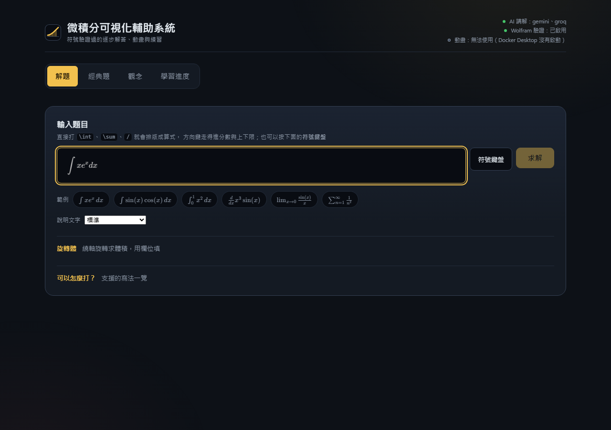

# 微積分可視化輔助系統（Calculus Visualizer）

> 一個以 React 19 + TypeScript（Vite）為前端、Python FastAPI 為後端、SQLite 存資料的微積分視覺化全端應用，用 LLM 多代理解題、SymPy 符號驗證，並透過 Docker 裡的 Manim 把解題過程算繪成解說影片。

*A full-stack calculus tutor: React 19 + TypeScript (Vite) front end, Python FastAPI back end, SQLite storage. Multiple LLM agents solve each problem, SymPy verifies the answer symbolically, and Manim (in Docker) renders the steps into an explainer video.*

> **這個 repo 只放展示資料，不含原始碼。** 專案本體為私有，著作權保留。

## 它做什麼

輸入一題微積分（直接打 `\int`、`\sum`，或用符號鍵盤），系統會：

1. **解題**：以逐步推導的方式給出答案，每一步標明用了哪個技巧（例如分部積分法）。
2. **驗證**：答案由 SymPy 做符號驗證，並可選用 Wolfram|Alpha 交叉比對。AI 只負責講解，**不決定答案對不對**；模型沒回應時，會退回內建說明，數學結果不受影響。
3. **講解**：把步驟算繪成動畫影片，左右方向鍵切換步驟，影片跳到對應片段。
4. **練習**：依這一題用到的技巧，推薦同類型的練習題，並記錄「自己解出來／不確定／直接看解答」，彙整成學習進度。

涵蓋極限、導數、積分、參數與極座標、級數、多變數微積分，另有一批預先製作的「經典題」講解影片。

## 畫面

| 首頁 | 解題與逐步推導 |
|---|---|
|  |  |

| 級數 | 手機版（輸入畫面） |
|---|---|
|  |  |

截圖取自本機執行的版本；動畫面板顯示「無法使用」是因為截圖當下沒有啟動 Docker，影片請看下方範例。

## 範例影片

| 影片 | 內容 |
|---|---|
| [`videos/derivative-D1-1.mp4`](videos/derivative-D1-1.mp4) | 用極限定義求 x² 的導數（約 1 分 40 秒） |
| [`videos/integral-I1-1.mp4`](videos/integral-I1-1.mp4) | 用矩形逼近拋物線下的面積（約 1 分 44 秒） |
| [`videos/series-PS3-1.mp4`](videos/series-PS3-1.mp4) | 收斂區間的兩個端點（約 1 分 46 秒） |

影片皆為本專案自行製作的原創講解。

## 技術

| 層 | 技術 |
|---|---|
| 前端 | React 19、TypeScript、Vite、KaTeX（排版）、MathLive（數學輸入）、Recharts |
| 後端 | Python 3.11+、FastAPI、Uvicorn、Pydantic v2、httpx |
| 數學 | SymPy（符號運算與驗證）、Wolfram\|Alpha（選用） |
| 資料 | SQLite |
| 算繪 | Manim Community，執行於 Docker 容器 |
| LLM | 多供應商可替換（Gemini、Groq 等）；無金鑰時以 SymPy 與內建模板運作 |
| 測試 | pytest、Vitest、Playwright（真瀏覽器打真伺服器） |

## 設計上值得一提的幾點

- **答案與講解分開**：數學正確性由符號運算決定，LLM 只負責說明，所以模型出錯或沒回應時答案仍然可靠。
- **全程可離線測試**：LLM、Wolfram、網路都有測試替身，整套測試不需要金鑰、不消耗額度。
- **題庫來源有授權意識**：外部題庫只在使用者的瀏覽器中取用、不在伺服器落地，以符合各來源的使用條款。

## 品質

後端測試套件於 2026-10-04 實跑：**2572 passed、11 skipped、0 failed**。

## 授權

本 repo 內的截圖、影片與文字著作權保留，未經許可不得轉載或再散布，見 [LICENSE](LICENSE)。
