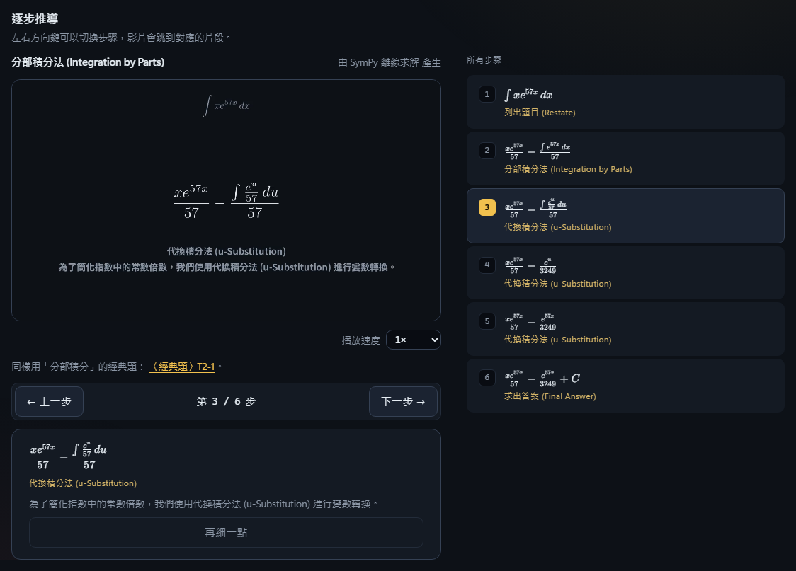
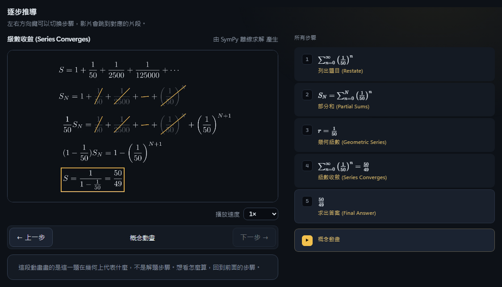
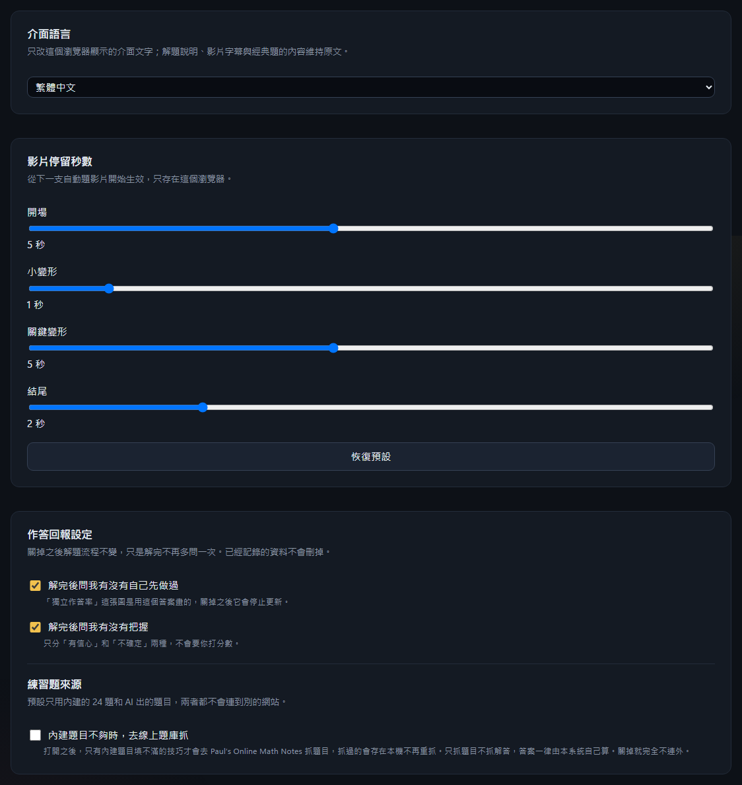

[English](README.md) | **繁體中文**

# 微積分可視化輔助系統（Calculus Visualizer）

> 一個以 React 19 + TypeScript（Vite）為前端、Python FastAPI 為後端、SQLite 存資料的微積分視覺化全端應用，用 LLM 多代理解題、SymPy 符號驗證，解題步驟直接在瀏覽器裡播成動畫，再由 Docker 裡的 Manim 算出每題的概念動畫。

*A full-stack calculus tutor: React 19 + TypeScript (Vite) front end, Python FastAPI back end, SQLite storage. Multiple LLM agents solve each problem, SymPy verifies the answer symbolically, the steps animate right in the browser, and Manim (in Docker) renders a concept animation for each problem.*

> **這個 repo 只放展示資料，不含原始碼。** 專案本體為私有，著作權保留。

## 它做什麼

輸入一題微積分（直接打 `\int`、`\sum`，或用符號鍵盤；旋轉體、泰勒展開這類題型從「題型」選單選，填欄位即可），系統會：

1. **解題**：以逐步推導的方式給出答案，每一步標明用了哪個技巧（例如分部積分法）。
2. **驗證**：答案由 SymPy 做符號驗證，並可選用 Wolfram|Alpha 交叉比對。AI 只負責講解，**不決定答案對不對**；模型沒回應時，會退回內建說明，數學結果不受影響。
3. **講解**：在瀏覽器裡把推導播成動畫，每一行只做一個變形：兩步共用的符號移到新位置、新的符號寫進來，可以暫停，左右方向鍵切換步驟。伺服器算的概念動畫接在最後一章。開場、小變形、關鍵變形、結尾各停幾秒，由設定頁的四支滑桿調整；每題解完附上同一個教學法的經典題連結。觀念動畫可以全部、按單元或按題型關掉。
4. **練習**：依這一題用到的技巧，推薦同類型的練習題，並記錄「自己解出來／不確定／直接看解答」，彙整成學習進度。

涵蓋極限、導數、積分、參數與極座標、級數、多變數微積分（含隱函數微分與多項式極限的 epsilon-delta 證明），另有一批預先製作的「經典題」講解影片。

## 畫面

| 符號鍵盤（輸入定積分到一半） | 分部積分：影片停在第 3 步，右側是全部步驟 |
|---|---|
|  |  |

| 等比級數：概念動畫與答案 | 手機版（解題後的第一屏） |
|---|---|
|  |  |

| 題型選單：選旋轉體、填欄位，送出前先看到要算的積分 |
|---|
|  |

| 設定：介面語言可切換繁體中文／English，影片停留秒數滑桿、觀念動畫開關；[英文版 README](README.md) 的截圖就是英文模式的畫面 |
|---|
|  |

截圖取自本機執行的版本。

## 範例影片

一支是預先製作的經典題講解，七支是系統收到題目後**自動生成**的，每種題型一支：逐步講解後接概念動畫，皆為 1080p30。這些是伺服器算的版本；現在 app 裡的步驟改在瀏覽器播，只有概念動畫是影片。

| 影片 | 內容 | 來源 |
|---|---|---|
| [`videos/classic-D1-4-abs-corner.mp4`](videos/classic-D1-4-abs-corner.mp4) | \|x\| 在 0 不可微：尖點兩側斜率不同（2 分 9 秒） | 預製經典題 |
| [`videos/auto-integral-by-parts.mp4`](videos/auto-integral-by-parts.mp4) | ∫ x eˣ dx，分部積分法（42 秒） | 自動生成 |
| [`videos/auto-derivative.mp4`](videos/auto-derivative.mp4) | d/dx ( x³ sin x )，求導數（38 秒） | 自動生成 |
| [`videos/auto-limit.mp4`](videos/auto-limit.mp4) | lim sin x / x（x→0），極限（28 秒） | 自動生成 |
| [`videos/auto-solid-of-revolution.mp4`](videos/auto-solid-of-revolution.mp4) | y = x² 在 [0, 1] 繞 x 軸，旋轉體體積（59 秒） | 自動生成 |
| [`videos/auto-taylor-series.mp4`](videos/auto-taylor-series.mp4) | sin x 在 0 的 5 階泰勒多項式（37 秒） | 自動生成 |
| [`videos/auto-series-geometric.mp4`](videos/auto-series-geometric.mp4) | Σ (1/2)ⁿ，等比級數，部分和收斂到 2（49 秒） | 自動生成 |
| [`videos/auto-partial-derivative.mp4`](videos/auto-partial-derivative.mp4) | ∂/∂x ( x²y + y³ )，偏導數與切線（39 秒） | 自動生成 |

影片皆為本專案自行製作。

## 技術

| 層 | 技術 |
|---|---|
| 前端 | React 19、TypeScript、Vite、KaTeX（排版）、MathLive（數學輸入）、Recharts |
| 後端 | Python 3.11+、FastAPI、Uvicorn、Pydantic v2、httpx |
| 數學 | SymPy（符號運算與驗證）、Wolfram\|Alpha（選用） |
| 資料 | SQLite |
| 算繪 | 步驟：瀏覽器裡用 KaTeX 播動畫。概念動畫與經典題講解：Manim Community，執行於 Docker 容器 |
| LLM | 多供應商可替換（Gemini、Groq 等）；無金鑰時以 SymPy 與內建模板運作 |
| 測試 | pytest、Vitest、Playwright（真瀏覽器打真伺服器） |

## 設計上值得一提的幾點

- **答案與講解分開**：數學正確性由符號運算決定，LLM 只負責說明，所以模型出錯或沒回應時答案仍然可靠。
- **全程可離線測試**：LLM、Wolfram、網路都有測試替身，整套測試不需要金鑰、不消耗額度。
- **題庫來源有授權意識**：外部題庫只在使用者的瀏覽器中取用、不在伺服器落地，以符合各來源的使用條款。

## 品質

後端測試套件於 2026-10-14 實跑：**3135 passed、12 skipped、1 failed**（平行套件；失敗的那條打真的第三方網站，單獨跑會過；序列真算繪 130 條最後一次實跑在 2026-10-12）。

## 授權

本 repo 內的截圖、影片與文字著作權保留，未經許可不得轉載或再散布，見 [LICENSE](LICENSE)。
